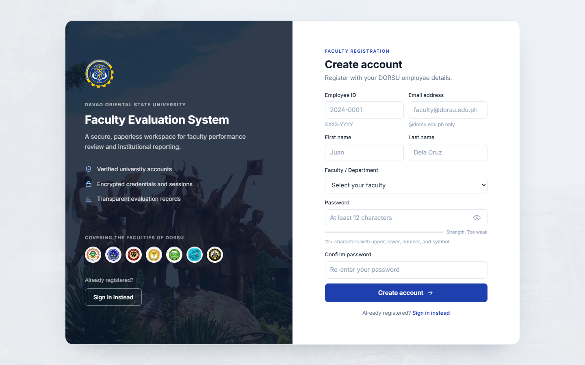

# Lab 1 — Registration and Login Pages Using PHP

**System:** DORSU Faculty Evaluation System
**Module:** Authentication (user registration, login validation, session management)
**Stack:** PHP 8.3+, MySQL 8.0, PDO, vanilla HTML/CSS/JS (no framework)
**Status:** Complete and verified

---

## 1. Objective

Develop a registration and login module in PHP for a Faculty Evaluation System, including:

- user registration
- login validation
- session management
- screenshots of the completed registration and login pages

This document covers **only Lab 1**. The evaluation workflow, admin panel, and reporting
belong to later labs and are out of scope here.

---

## 2. Screenshots

### 2.1 Login page


Single-page slider: the sign-in panel on the left, DORSU branding and the seven faculty
seals on the right. "Create an account" slides the register panel into view.

### 2.2 Registration page



The register panel collects the employee ID, institutional email, name, faculty, and
password. The DORSU seal, campus background, and faculty logo strip stay on the brand side.

---

## 3. How the two pages work

Both pages are one file — `public/index.php` — with a CSS/JS slider that moves between two
panels. This keeps the branding in place while the user switches between signing in and
registering.

| URL | Result |
| --- | --- |
| `/index.php` | Login panel |
| `/index.php?mode=register` | Registration panel |
| `POST /index.php` with `action=login` | Login submission |
| `POST /index.php` with `action=register` | Registration submission |
| `/logout.php` | Destroys the session and returns to login |

An authenticated visitor who opens `/index.php` is redirected straight to `/dashboard.php`.

---

## 4. Registration module

### 4.1 Fields

| Field | Input name | Rules |
| --- | --- | --- |
| Employee ID | `employee_id` | Required, `XXXX-YYYY` (e.g. `2024-0001`), unique |
| Email address | `email` | Required, must end in `@dorsu.edu.ph`, lower-cased, unique |
| First name | `first_name` | Required, 1–100 characters, letters/space/apostrophe/hyphen |
| Last name | `last_name` | Required, 1–100 characters, letters/space/apostrophe/hyphen |
| Faculty / Department | `department` | Required, must be one of the seven configured faculties |
| Password | `password` | 12+ characters, upper-case, lower-case, digit, and one of `@ $ ! % * ? &` |
| Confirm password | `confirm_password` | Must match `password` |

### 4.2 Validation

Validation runs in two layers:

1. **Client side** — `public/assets/js/main.js` shows a live password-strength meter and
   inline hints while typing.
2. **Server side** — `RegisterDTO::validate()` (`src/Auth/DTO/RegisterDTO.php`) is the
   authority. It re-checks every rule with `src/Shared/Validation.php` and returns a map of
   field → message. The controller renders those messages under the matching input, so the
   browser can never bypass a rule.

After field validation the service also rejects duplicates:

- `An account with this email already exists`
- `An account with this employee ID already exists`

### 4.3 What gets stored

The password is never stored in plain text:

```php
password_hash($dto->password, PASSWORD_BCRYPT, ["cost" => 12]);
```

New accounts are created with `role = faculty` and `status = active`, then logged in
immediately (session id regenerated) and redirected to the dashboard.

### 4.4 Registration flow

```
GET  /index.php?mode=register   → render empty form
POST /index.php (action=register)
      → verify CSRF token
      → validate fields + password confirmation
      → check duplicate email / employee ID
      → bcrypt hash + INSERT into users
      → session_regenerate_id(true) + store user id
      → 302 redirect to /dashboard.php
```

Any failure re-renders the form with the submitted values preserved (except the password)
and the error message attached to the field.

---

## 5. Login module

### 5.1 Fields

| Field | Input name | Rules |
| --- | --- | --- |
| Email address | `email` | Required, valid `@dorsu.edu.ph` address |
| Password | `password` | Required |
| Remember me | `remember_me` | Optional checkbox |

### 5.2 Validation and failure handling

| Situation | Behaviour |
| --- | --- |
| Missing/invalid email format | Field error, form re-rendered |
| Wrong email **or** wrong password | Same generic message: `Invalid credentials` (does not reveal which one was wrong) |
| Account inactive or locked | `Account is not active or has been locked` |
| 5 failed attempts within 15 minutes | Account locked for 15 minutes, plus a rate-limit message showing minutes remaining |
| Successful login | Failed-attempt counter reset, `last_login_at` updated, session id regenerated |

Password checking uses `password_verify()` against the bcrypt hash, so timing and comparison
are handled by PHP's constant-time implementation.

### 5.3 Remember me

"Remember me" **does not** keep the user signed in and does **not** extend the session
lifetime. It only prefills the sign-in form:

- On a successful login with the box checked, the email address is saved in a 30-day
  `HttpOnly` cookie (`dorsu_remember_email`). Unchecking the box clears it.
- On the next visit the email field is prefilled and the checkbox is already ticked.
- The password is never stored by the application. The form uses
  `autocomplete="username"` / `autocomplete="current-password"`, so the browser's own
  password manager fills the saved password. Writing a plaintext password into a cookie
  would expose it to anyone with access to the machine, so the browser credential store is
  used instead.

The session itself still expires with `SESSION_LIFETIME` (120 minutes) and logout destroys
it.

### 5.4 Login flow

```
GET  /index.php                → render empty form
POST /index.php (action=login)
      → verify CSRF token
      → validate email format
      → check rate limit / lockout
      → find user by email
      → password_verify()
      → check status = active and locked_until
      → reset counters, update last_login_at
      → session_regenerate_id(true), store user id
      → if "Remember me": save email in a 30-day cookie (never the password)
      → 302 redirect to /dashboard.php
```

---

## 6. Session management

Implemented in `src/Shared/Session.php`.

| Concern | Implementation |
| --- | --- |
| Cookie flags | `HttpOnly`, `SameSite=Strict`, `Secure` when `SESSION_SECURE_COOKIE=true`, custom name, path `/` |
| Fixation defence | `session_regenerate_id(true)` on register and on every successful login |
| Session data | Only the user id is stored; the user record is reloaded per request |
| Idle timeout | `SESSION_LIFETIME=120` minutes (PHP GC max lifetime) |
| Remember me | Email only, 30-day `HttpOnly` cookie for prefilling; no session extension |
| Logout | `Session::destroy()` — clears `$_SESSION`, expires the cookie, `session_destroy()` |
| CSRF | 64-character synchronizer token in the session, compared per POST |
| Flash messages | One-shot messages consumed on the next render |

Route protection lives in `src/Auth/Middleware/AuthMiddleware.php`; pages that need a user
call `requireAuth()` and are redirected to `/index.php` when there is no valid session.

---

## 7. Security measures in this module

| Threat | Mitigation |
| --- | --- |
| SQL injection | PDO prepared statements only (`UserRepository`) |
| XSS | All output escaped through `e()` (`htmlspecialchars`, `ENT_QUOTES`, UTF-8) |
| CSRF | Per-session token on both forms, verified before any write |
| Brute force | File-based rate limiter (5 attempts / 15 min) + account lockout |
| Credential stuffing | Generic `Invalid credentials` message, no account enumeration on login |
| Password cracking | bcrypt cost 12 |
| Session hijacking | HttpOnly + SameSite=Strict cookies, id regeneration, logout invalidation |
| Unauthorised email domains | Server-side `@dorsu.edu.ph` allow-list |
| Clickjacking / MIME sniffing | `X-Frame-Options: DENY`, `X-Content-Type-Options: nosniff` |
| Script injection | Content-Security-Policy header, no inline event handlers |
| Audit trail | Login, registration, and logout events written to the append-only audit log |

---

## 8. Files that make up Lab 1

```
public/index.php                        Login + registration controller (slider)
public/register.php                     302 → /index.php?mode=register (legacy URL)
public/logout.php                       Session destroy + redirect
public/dashboard.php                    Post-login landing page (protected)
public/assets/css/style.css             Auth slider, form, and brand-panel styles
public/assets/js/main.js                Slider, password strength, password visibility
templates/auth/auth-slider.php          Markup for both panels
templates/layout.php                    Shared shell, CSP and security meta tags
src/Auth/DTO/LoginDTO.php               Login input + validation
src/Auth/DTO/RegisterDTO.php            Registration input + validation
src/Auth/Service/AuthService.php        register(), login(), logout(), getCurrentUser()
src/Auth/Service/RateLimiter.php        Attempt window + lockout counters
src/Auth/Repository/UserRepository.php  Prepared-statement data access
src/Auth/Entity/User.php                User entity (role, status, canLogin())
src/Auth/Entity/UserRole.php            admin | chair | faculty
src/Auth/Entity/UserStatus.php          active | inactive | locked
src/Auth/Middleware/AuthMiddleware.php  Route protection
src/Auth/Middleware/CsrfMiddleware.php  Token generation + verification
src/Shared/Session.php                  Secure session bootstrap and lifecycle
src/Shared/Validation.php               Email, employee ID, name, password rules
database/migrations/001_create_users_table.php
tests/                                  PHPUnit coverage for the above
```

---

## 9. Database

Table `users` (MySQL, `utf8mb4_unicode_ci`):

| Column | Type | Notes |
| --- | --- | --- |
| `id` | INT AUTO_INCREMENT | Primary key |
| `employee_id` | VARCHAR(20) | Unique |
| `email` | VARCHAR(255) | Unique |
| `password_hash` | VARCHAR(255) | bcrypt, cost 12 |
| `first_name`, `last_name` | VARCHAR(100) | |
| `department` | VARCHAR(150) | One of the seven faculties |
| `role` | VARCHAR(20) | `faculty` by default |
| `status` | VARCHAR(20) | `active` by default |
| `email_verified_at` | DATETIME NULL | Reserved for a later lab |
| `last_login_at` | DATETIME NULL | Updated on each successful login |
| `failed_login_attempts` | INT | Reset on success |
| `locked_until` | DATETIME NULL | Set when the lockout threshold is hit |
| `created_at`, `updated_at` | DATETIME | Automatic |

The seven faculties come from `.env` (`DEPARTMENTS`, pipe-separated because the names
contain commas):

```
Faculty of Computing, Engineering, and Technology
Faculty of Teacher Education
Faculty of Criminal Justice Education
Faculty of Nursing and Allied Health Sciences
Faculty of Agriculture and Life Sciences
Faculty of Humanities, Social Sciences, and Communication
Faculty of Business and Management
```

---

## 10. Running the module

```bash
# 1. Install dependencies
composer install

# 2. Create .env from the template and set DB credentials
copy .env.example .env

# 3. Create the database and run migrations
php database/migrate.php

# 4. Start the development server
php -S localhost:8000 -t public
```

Open <http://localhost:8000>.

### Demo accounts

| Email | Role | Password |
| --- | --- | --- |
| `admin@dorsu.edu.ph` | admin | `DorsuEval2026!` |
| `chair@dorsu.edu.ph` | chair | `DorsuEval2026!` |
| `faculty1@dorsu.edu.ph` | faculty | `DorsuEval2026!` |

> Demo credentials only — replace them before any real deployment.

---

## 11. Verification evidence

**Automated:** `vendor\bin\phpunit --configuration phpunit.xml`

```
................................                                  32 / 32 (100%)
OK (32 tests, 75 assertions)
```

Coverage includes registration validation, duplicate email/employee ID rejection, bcrypt
hashing, login success/failure, rate limiting, lockout, CSRF rejection, session
regeneration, and logout invalidation.

**Manual end-to-end (HTTP):**

| Check | Result |
| --- | --- |
| `GET /index.php` | 200, login form + CSRF token |
| `GET /index.php?mode=register` | 200, registration form |
| Register a new faculty account | 200 → redirect `/dashboard.php`, session created |
| Session user name rendered in the shell | `Lab Verify` |
| `GET /dashboard.php` while signed in | 200, dashboard |
| `GET /logout.php` then `/dashboard.php` | redirected to `/index.php` |
| Login with wrong password | `Invalid credentials`, attempt counted |
| 6th attempt inside 15 minutes | rate-limit / lockout message |

---

## 12. Scope notes for the next lab

Lab 1 stops at authentication. The following are intentionally **not** part of it:

- password reset / "Forgot password" flow (link is present, page is not built)
- email verification (`email_verified_at` is reserved but unused)
- evaluation periods, criteria, and scoring
- admin user management and reporting
- the Reports and Settings sidebar entries are placeholders (`href="#"`)

Everything beyond authentication is scaffolded in `src/Evaluation` and
`public/evaluations.php` for later labs.
